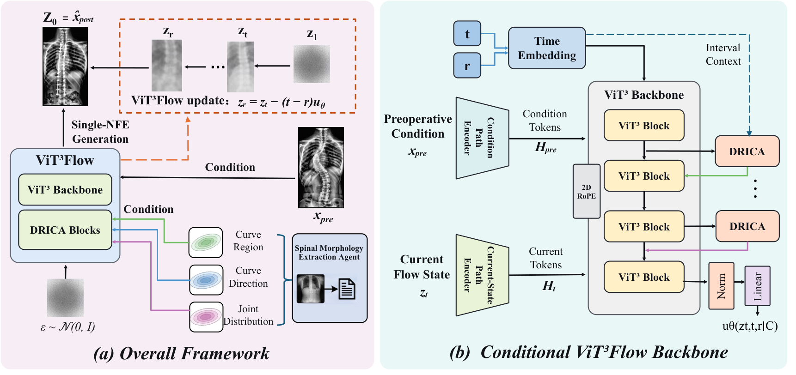
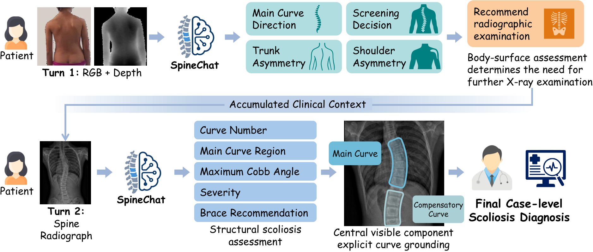

# ***Spine Intelligence***

### *Advancing Spine Imaging, Understanding, and Clinical Intelligence*

**Multimodal assessment · Clinical evidence grounding · Postoperative synthesis**

[**Project Website ↗**](https://Tomry1114.github.io/Spine-Intelligence/) &ensp;·&ensp; [**ViT3Flow ↗**](https://Tomry1114.github.io/Spine-Intelligence/vit3flow.html) &ensp;·&ensp; [**SpineChat ↗**](https://Tomry1114.github.io/Spine-Intelligence/spinechat.html)

**Spine Intelligence** brings together our research on AI for spinal deformity assessment and scoliosis surgical planning. Explore each project's dedicated page for its graphical abstract and resources.

## Projects

| Project | Research focus | Project page | Code |
| :--- | :--- | :--- | :--- |
| **ViT3Flow** | Patient-specific postoperative radiograph synthesis | [Visit project ↗](https://Tomry1114.github.io/Spine-Intelligence/vit3flow.html) | Coming soon |
| **SpineChat** | Multi-turn multimodal spinal deformity assessment | [Visit project ↗](https://Tomry1114.github.io/Spine-Intelligence/spinechat.html) | [GitHub](https://github.com/Tomry1114/SpineChat) |

## Resources

| Dataset | Associated project | Access |
| :--- | :--- | :--- |
| **ScoliSurg** | ViT3Flow | To be announced |
| **SpineVQA** | SpineChat | To be announced |

Paper links, code, checkpoints, and dataset access information will be added progressively. These are research systems; no patient datasets are distributed here.

## Contact

[Rui Tang](https://github.com/Tomry1114) · The University of Hong Kong  
For questions and collaboration, please open an Issue.
